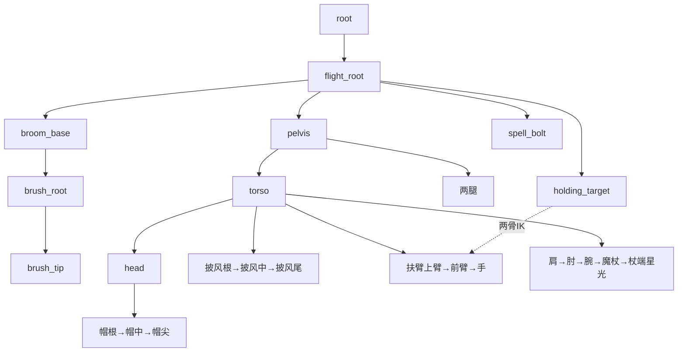

# 绿豆巫师：可复建样例

这份动动 Dodo 样例保留用户认可的绿豆巫师及三个动作。它用于检查工作台搬离原项目后能否重建同一作品。新作品应复制到新任务目录后适配；本例的坐标和控制数量不作为新素材的绑定规则。第三方工具和素材范围见 [THIRD_PARTY.md](../../THIRD_PARTY.md)。


## 目标与制作来源

| 项目 | 本样例的选择 |
| --- | --- |
| 视角与用途 | 固定三分之四视角、骑扫帚的小型角色演出；没有设计转身或背面 |
| 美术 | 内置 image_gen 生成的原创形象；采用 agent-sprite-forge 的静态主图方法。保留可见原像素，局部补足被遮挡的腹部、木柄、颈部与披风布面 |
| 骨架 | 为这张图和三个动作手工设计控制关系，再由脚本编译成标准 Spine JSON；没有套用别人的成品骨架 |
| 动作 | 为本角色编写关键帧、缓动和释放时序；没有复用别人的动作数据 |
| 工具 | 复用固定版本 Rigby2D 的数据模型、坐标计算、IK、格式转换和 WebGL 渲染器 |

原图、提示、补画图、来源分类与 SHA-256 在 [source/provenance.json](source/provenance.json)。生成式补画的输入 PNG 已保存；复建从这些确定文件开始。再次运行生成提示，不能保证得到同一组像素。

## 动作如何决定控制关系

| 动作 | 要看见什么 | 必须保持什么 |
| --- | --- | --- |
| `fly`，4 秒循环 | 整体轻浮动，腿、帽尖、披风和扫帚穗错峰摆动 | 握持点贴住扫帚；脸、木柄和魔杖保留形状 |
| `charge`，2.8 秒单次 | 肩、肘、腕逐级举杖，杖端星光增强，然后回到初始姿态 | 头胸连接连续；举臂时不露腹部或肩根缺口 |
| `cast`，2.2 秒单次 | 预备、前挥、释放、后坐、恢复；`cast_release` 在 0.68 秒触发 | 星光释放后有独立轨迹，角色及连接面不被拉开 |

`charge` 与 `cast` 都有明确的回到初始姿态设计，因此本例会检查首尾一致。通用验证器不要求所有单次动画回到起点。



实际骨架见 [source/rig_spec.json](source/rig_spec.json)，实际关键帧见 [source/actions.json](source/actions.json)。图中省略了部分技术控制。

- `flight_root` 负责整体演出，扫帚与身体有独立下级控制。
- 扶扫帚手使用 IK 维持选定握点；施法臂使用肩、肘、腕控制主动表演。
- 魔杖和木柄按刚体处理；帽、披风、扫帚穗使用加权网格。
- 头、身体、衣领与连接底面在同源位置使用一致的变形场；披风根部接入该场，远端保留摆动。
- 杖端星光跟随魔杖；释放星光归 `flight_root`。它脱离魔杖旋转，仍处于角色局部空间。游戏世界独立弹道需要宿主运行时接管。

本图使用 26 根骨骼、15 张部件贴图和 16 个 slot。拆分遮罩、网格密度、坐标阈值与动作幅度均属于本例，不能直接当成陌生图的自动绑骨规则。

## 复建

在工作台根目录按 [主 README](../../README.md) 准备 Node 与 Python 依赖，然后运行：

```sh
node scripts/workbench.mjs build examples/bean-wizard --exchange
node scripts/workbench.mjs preview examples/bean-wizard --port 3050
```

流程为：

1. `scripts/build.mjs` 调用本例 `split_art.py`，从原图及四张补画图重建部件与重组图。
2. `build_rig.mjs` 编译本例骨架与动作，输出 `build/bean-wizard-source.json`。
3. 工作台从标准 JSON 和部件 PNG 生成 `exports/` 中的可编辑项目、图集与交换格式。
4. 通用结构检查通过后，`scripts/verify.mjs` 运行本例专用运动与颈部覆盖检查。

`reference/bean-wizard.rigby` 和 `reference/bean-wizard-cast-1080p.mp4` 是已认可作品的快照；构建过程不读取这两个文件。比较时检查图像及运动，不依赖 ZIP 字节完全相同。

## 本例检查的范围

| 检查 | 自动执行什么 | 仍需看什么 |
| --- | --- | --- |
| 拆图重组 | 保留原图已绘制区域；记录隐藏面补画和肩根新增覆盖 | 材质、颜色、外轮廓是否自然 |
| 初始绑定 | 所有部件和映射完整；PNG 尺寸匹配；初始网格回到源图位置 | 支点是否符合动作意图 |
| 运动 | 60 Hz 共 543 帧；握点误差、网格面积、共享顶点位置、弹道边界、首尾恢复 | IK 目标位置是否选得对，挥杖节奏是否好看 |
| 颈部内部连接带 | 导出网格与 PNG 的双相位 alpha 探针，包含连接边界 | 不覆盖外轮廓、颜色接缝、图集过滤、动作混合和游戏播放 |
| 网页 | 使用固定版本 Rigby2D WebGL 渲染器预览 | 缩到目标显示尺寸后看节奏、穿帮和轮廓 |

每次重建的明细保存在 `evidence/`，通用打包报告在 `exports/`。官方 Spine 编辑器、官方 Spine runtime 及 C++/Skia 游戏未在本工作台中验收。

## 可复现的施法视频

按上述 3050 端口启动服务后，打开 [视频导出页面](http://127.0.0.1:3050/examples/bean-wizard/scripts/render-cast.html)。它从新建的 `.rigby` 加载所有图像，调用固定 Rigby2D 的官方 `renderJob`：0.4 秒初始姿态、2.2 秒完整施法、0.4 秒结束姿态；1080×1080、30 fps、90 帧，无音轨。使用支持 WebCodecs H.264 的 Chromium 浏览器。

下载 `bean-wizard-cast-native.mp4` 后，可从工作台根目录运行：

```sh
node examples/bean-wizard/scripts/finalize-cast.mjs /实际下载路径/bean-wizard-cast-native.mp4
```

此步需要 PATH 中的 FFmpeg，或设置 `ANIMATION_FFMPEG` 为其路径；输出 `exports/bean-wizard-cast-1080p.mp4`，编码为 H.264/yuv420p 并设置 faststart。视频来自骨架逐帧渲染，不调用生成视频模型。
