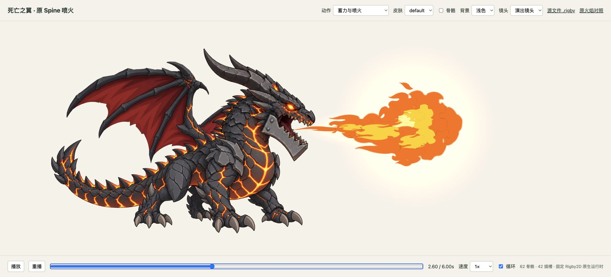

# 死亡之翼：复用原 Spine 喷火

[角色网页默认地址](http://127.0.0.1:3067/project/web/index.html) · [原火焰对照页面](web/original-fire.html)，需先运行下文 `preview`。

这是动动 Dodo 的独立素材样例，时长 6 秒，网页使用固定 Rigby2D 运行时。组合构建和离线采样使用随包的官方 Spine 3.8 runtime，许可范围见 [THIRD_PARTY.md](../../THIRD_PARTY.md)。

复制到新电脑或新作品目录后，重新运行下文 `preview` 命令并使用实际地址。在角色网页通过相对链接 `./original-fire.html` 打开原火焰对照，页面与角色共用当前 preview 服务的 origin；默认地址为 `http://127.0.0.1:3067/project/web/original-fire.html`。原效果数据和图片保存在 [source/native-fire.json](source/native-fire.json) 与 `assets/parts/native/` 的五张 PNG，能够独立播放，不依赖历史的仓库外 3066 研究服务。制作新作品应复制到新任务目录后适配，保留本认可案例。

2026-10-22，用户认可本版喷火和 MP4，并明确要求作为 SOP 经验保留。认可覆盖本次形象与动画表现；目标引擎和设备的验证范围见下文。

## 复用了什么

- **角色**：沿用已确认的死亡之翼美术、18 根身体骨骼、4 个身体插槽和原 6 秒身体动作。没有新增角色绘画。
- **火焰**：来自用户提供的 `fire.spine`，恢复原 43 根骨骼、38 个插槽、39 个附件、5 条动画、444 条轨道和 3,534 个关键帧；5 张原 PNG 的哈希一致。
- **本次适配**：增加一个喷口挂接骨骼，注册原喷口位置、调整整体尺度，并编排原 `effect` 启动片段、`ing` 循环与 `end` 消散。合计 62 根骨骼、42 个插槽。原 5 条动作另以 `native__` 前缀完整保留。

合成动作 `breathe_fire` 在 1.65 秒开始喷射，1.85 秒进入持续段，3.70 秒开始收束，约 4.10 秒消失。片段衔接使用标准 AnimationState 混合，混合时间 0.08 秒；新组合轨道按 60 Hz 采样，火焰原动作没有重新设计。

## 文件

| 路径 | 用途 |
| --- | --- |
| `source/body.json` | 保留的角色骨架、蒙皮与身体动画 |
| `source/native-fire.json` | 从原 `.spine` 恢复的 3.8.99 格式数据；原编辑器版本为 3.8.75 |
| `source/rig_spec.json` | 喷射时段、世界尺度和固定镜头 |
| `source/provenance.json` | 输入来源、版本与逐图 SHA-256 |
| `assets/parts/` | 4 张角色原图与 `native/` 下 5 张火焰原图 |
| `build/deathwing-native-fire-source.json` | 合成后的 3.8.99 源数据 |
| `exports/deathwing-native-fire.rigby` | Rigby2D 可编辑工程 |
| `exports/deathwing-native-fire.json` | 工作台导出的主 JSON |
| `exports/deathwing-native-fire.4.3.json`、`.skel` | 4.3 交换格式；验证范围见下文 |
| `exports/deathwing-native-fire.atlas`、`.png` | 图集与 2048×2048 纹理 |
| `scripts/` | 组合、验证、固定时间采样与渲染脚本 |
| `web/original-fire.html` | 同一预览服务内的原火焰独立对照 |

## 复现

保留本样例在完整工作台中的相对目录。基础构建需要 Node.js，以及安装 Pillow 的 Python 3；工作台自带固定版本 Rigby2D 源码。已有 `source/` 和 `assets/` 即可重建，不依赖原电脑 Downloads 路径。

从工作台根目录执行：

```sh
node scripts/workbench.mjs build examples/deathwing-native-fire --python python3 --exchange
node scripts/workbench.mjs validate examples/deathwing-native-fire --python python3
node scripts/workbench.mjs preview examples/deathwing-native-fire --port 3067
```

然后打开上面的角色网页。`?time=2.6&paused=1` 可定位固定实帧；网页支持播放、重播、拖动时间、骨骼显示与背景切换。

如需重建独立软件渲染实帧，先在 `validation/spine-consumer/` 执行 `npm ci`，固定依赖为 `rig-c@2.65.1`、`bun@1.4.3`、`@esotericsoftware/spine-core@4.3.13`，再从工作台根目录执行：

```sh
node examples/deathwing-native-fire/scripts/sample_composite.mjs
validation/spine-consumer/node_modules/.bin/bun examples/deathwing-native-fire/scripts/render_composite.ts
```

分享用 MP4 从原骨架逐帧渲染，输出 1920×1080、60 fps、6 秒，不包含网页控件。完成上面的独立依赖安装后执行：

```sh
validation/spine-consumer/node_modules/.bin/bun examples/deathwing-native-fire/scripts/export_mp4.ts --ffmpeg ffmpeg
```

结果为 `exports/deathwing-native-fire.mp4`，输入哈希、采样范围和编码参数保存在 `evidence/mp4-export.json`。

原 `.spine` 的四脚本离线恢复过程另见随工作台携带的 [读取器说明](../../scripts/spine38-reader/README.md)。读取器只依赖 Python 标准库，目前仅验证本次两个 3.8 工程结构；工具包不附带第三方原工程。

## 验证与实际画面

`evidence/verification.json` 已通过：角色骨骼和身体轨道一致、5 条原动画一致、9 张输入图哈希一致、4,630 个加权骨骼引用合法；361 个身体矩阵样本最大差 0，148 个喷口样本最大位置误差约 3.21e-7。

`exports/validation.json` 已通过固定 Rigby2D 的解析、往返和有限值检查。JSON 的小数舍入与二进制 float32 精度不同，离散附件关键帧恰在采样边界时可能落在相邻采样步；这些结果不能宣称官方 JSON/binary 逐帧完全等价。官方编辑器重导入、C++/Skia、手机和游戏接入尚未验证。

本例严格对照在约 3.983333 秒的 `native__fire_45` 附件切为 null 时触及精度边界：交换 JSON 时间为 3.98333，binary 约为 3.983333349，相差约 3.35 微秒。两侧在恰好采样的时刻得到不同附件列表；该差异保留，没有为获得零差异而提前移动关键帧。

网页已实际检查 1.78、2.60、3.40、4.15 秒，验证喷口跟随、深浅背景下 normal/additive 混合、完全消散、时间拖动、骨骼开关和重播。截图与范围记录在 `evidence/web-review.json`。其中记录了一条来源未确认的浏览器消息连接错误，没有观察到对应的渲染失败；不把它报告为控制台零错误。



## 来源和许可

火焰为用户提供的教程源工程复用，未确认商用或再分发许可；角色为暴雪 IP「死亡之翼 / Deathwing」的同人技术演示，生成美术不替代相关 IP 使用授权。来源和范围见 [THIRD_PARTY.md](../../THIRD_PARTY.md)。原素材公开可下载不代表开源商用。

网页使用 Rigby2D（固定提交 `6069ae2ef8cfbb622053a84e7ccd4acc74c06415`），许可见工作台 vendor。`source/spine-webgl-3.8.js` 仅用于本次离线动作采样和独立检查，按固定提交保留原文件；其独立许可原文为 `source/SPINE-RUNTIME-LICENSE`，不能与 Rigby2D 的 MIT/Apache 许可混同。
