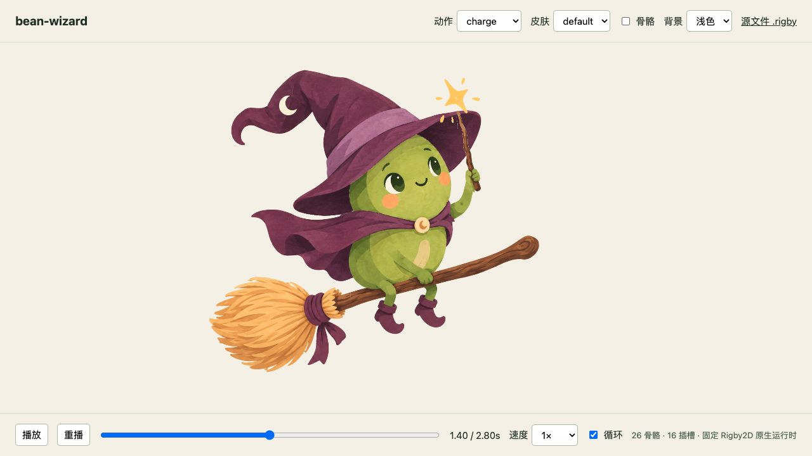
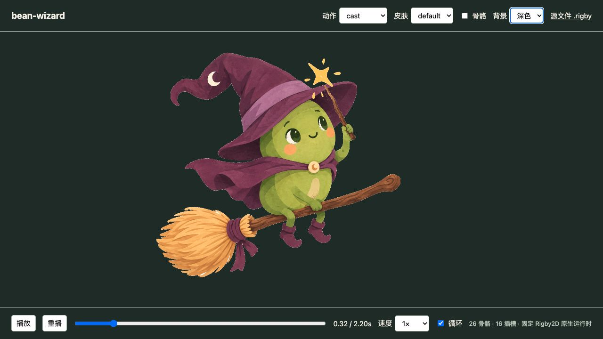

# 动动 Dodo：整理与复建记录

以下是 2026-10-21 至 2026-10-22 整理阶段的实际记录，发生在动动 Dodo 私人仓库发布前。记录只证明对应输入与当时环境，不代表后续新作品或新电脑已完成验收。

发布包保留汇总报告、关键画面与可复跑工具，不携带重复的冷启动工程、逐字段解析研究输出、缓存和未认可动作研究。报告中的旧绝对路径与端口是历史取证信息；当前使用方式以 [README](../README.md) 和三个认可案例为准。新作品和新的验证输出写到当前任务目录，不覆盖这些历史记录。

JSON 与 binary 的官方 Spine 消费比较使用独立的 [spine-consumer 入口](spine-consumer/README.md)，其输入快照、依赖和结果单独记录，不改变下面巫师整理验证的范围。

## 实际验证

| 项目 | 本轮结果 |
| --- | --- |
| Skill | `quick_validate.py` 通过；入口与本地文档链接检查通过 |
| 通用工具 | 6 项测试通过，覆盖加权网格、缺图与坏数据拒绝、打包/项目验收顺序、明确失败、陈旧导出拒绝、相对 Python 路径 |
| 干净副本复建 | 整个目录复制到含空格的独立临时路径；不带样例 `assets/`、`build/`、`exports/`、`evidence/`；从认可原图和四张补画图重新拆分、编译、打包并验收，通过 |
| 原作品比较 | 15 张嵌入 PNG 字节一致；三个动作按 60 Hz 共 543 帧比较拓扑、UV、位置与颜色，最大几何误差 0、最大颜色误差 0 |
| 初始注册与运动 | 26 骨骼、16 slot、10 个加权网格；握点最大误差约 `1.3e-13` 源图像素；最小三角形面积比约 `0.306`；共享连接顶点误差 0 |
| 内部颈部覆盖 | 543 帧 × 17,960 探针，共 9,752,280 次 alpha 采样；指定区域最低 alpha 为 1，失败帧 0；范围限制见样例说明 |
| 网页实际播放 | `http://127.0.0.1:3050/`，1280×720；使用交付 JSON、atlas 与 PNG，在内置 Rigby WebGL 渲染器加载并播放；动作选择、暂停/定位、骨骼叠加、浅/深背景实际操作通过；捕获的 warn/error 日志为空 |
| MP4 | 保留用户已认可的施法 MP4 及原生离线渲染入口；本轮没有重新导出视频 |

验证环境：macOS 26.5.1 / arm64，Node 24.18.0，Python 3.12.14，NumPy 2.3.5，Pillow 12.3.0；Rigby2D 固定提交见 vendor 清单。本轮使用已安装依赖的 Python，并通过含空格的相对解释器入口测试调用；没有声称在全新操作系统上完成依赖安装。

## 复现方式

在工作台根目录准备依赖，然后运行：

```sh
node scripts/workbench.mjs build examples/bean-wizard --python .venv/bin/python --exchange
node scripts/workbench.mjs validate examples/bean-wizard --python .venv/bin/python
node validation/compare-reference.mjs examples/bean-wizard/reference/bean-wizard.rigby examples/bean-wizard/exports/bean-wizard.rigby validation/reference-comparison.json
ANIMATION_PYTHON=.venv/bin/python node --test tests/*.test.mjs
node scripts/workbench.mjs preview examples/bean-wizard --port 3050
```

PowerShell 使用 `.venv\Scripts\python.exe`；运行通用测试前设置 `$env:ANIMATION_PYTHON` 为该解释器。依赖版本变化可能改变 PNG 编码字节，严格比较失败时需要判断像素与运动是否实际改变，不能跳过检查后继续声称字节一致。

## 证据位置

- [与认可版本的比较](reference-comparison.json)
- [本轮构建清单](../examples/bean-wizard/exports/build-manifest.json) 和 [通用验证](../examples/bean-wizard/exports/validation.json)
- [绑定与初始几何](../examples/bean-wizard/evidence/rig-build.json)
- [运动检查](../examples/bean-wizard/evidence/motion-verification.json)
- [颈部覆盖及范围](../examples/bean-wizard/evidence/neck-coverage-verification.json)
- [来源与补画记录](../examples/bean-wizard/source/provenance.json)

## 下一次制作要验证什么

用新静态素材和明确动作目标，按 Skill 重新分析部件、支点、接触与遮挡；先交付结构判断和关键试姿，再完成动作。不能直接迁移巫师的坐标或控制数量。

本轮证明了整理后的工具能脱离原项目复建已成功作品。陌生素材的制作成功率、返工量、低成本模型替代、跨操作系统以及官方 Spine/C++/Skia 游戏播放尚未验证。

## 2026-10-22：成熟效果复用与规则复核

死亡之翼原生喷火及分享 MP4 已获用户认可，入口和证据见 [样例](../examples/deathwing-native-fire/README.md)。本次规则整理补充了独特形象与通用效果分别选材、原样播放后适配、动态接口与父级变换、片段编排、additive 混合、离散时间边界以及完整 MP4 解码；具体参数保留在样例。

读取器已整理进 `scripts/spine38-reader/`，不附第三方素材。从独立 cwd 实际执行复制后的入口，读取已核验的 3.8.75 与 3.8.99 两份工程，两份恢复 JSON 均与研究阶段产物逐字节一致，原件哈希不变；缺少必需参数的 3 个用例均明确失败，见 [复现报告](spine38-reader-reproduction.json)。这验证的是这两份结构和便携入口，未扩大格式支持范围。

独立代理只读取技能与引用，针对新请求“认可的侧面冰法师图、举杖、发射冰锥、命中爆开、未知版本 effect.spine、网页与 MP4、引擎未定”制定制作计划。其结果按实际材料检查原工程和 reader，分别考虑角色动作与成熟冰系效果，先试姿，再处理杖尖跟随、释放后世界轨迹和命中时序，并把未来引擎验收单列。该检查验证规则能引导新任务的计划，未实际制作第二个作品，也不能据此判断成品质量或低成本模型能力。

本次仅整理本地规则、可携带脚本与认可状态，没有重新渲染动画、修改游戏或上传远端。Skill 格式和链接另在整理时检查，不替代作品验收。

## 2026-10-22：README 无上下文启动检查

根目录新增简短 `AGENTS.md`，导航到 README 的启动说明与 SKILL；README 补充调用示例、能力和环境检查、新作品目录、工具与制作职责、迁移路径和本机预览地址的处理。

一个未继承本次对话的独立 AI 从这些入口执行本地复用任务，当时实际建立 `readme-cold-start/project/`，运行 `init`、`build --exchange`、单独 `validate` 并启动新预览服务。39 个 HTTP 资源通过，16 个重建源/交付文件与认可案例哈希一致；命令、解释器发现和测量范围见 [完整报告](readme-cold-start-report.json)。重复项目未随仓库提供；原案例的源与导出未因该测试改变。

发现的迁移注意点已经补进说明：本机默认 `.venv` 不保证存在，需使用当前可用环境；案例专用脚本的外部相对引用应随复制位置检查。发布包已将原火焰对照页收进同一项目 `web/original-fire.html`，通过当前 preview 服务打开，不依赖历史 3066 服务。该冷启动测试没有浏览器/WebGL 视觉验收，没有生成陌生新形象或重复导出 MP4，也未在新操作系统安装依赖。




